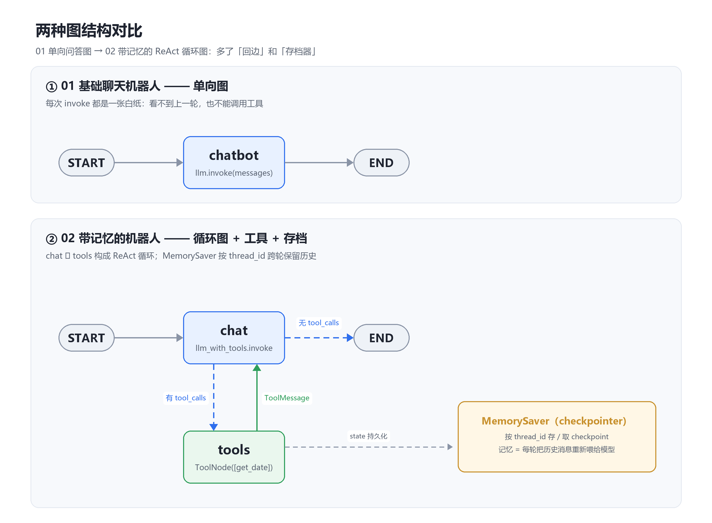
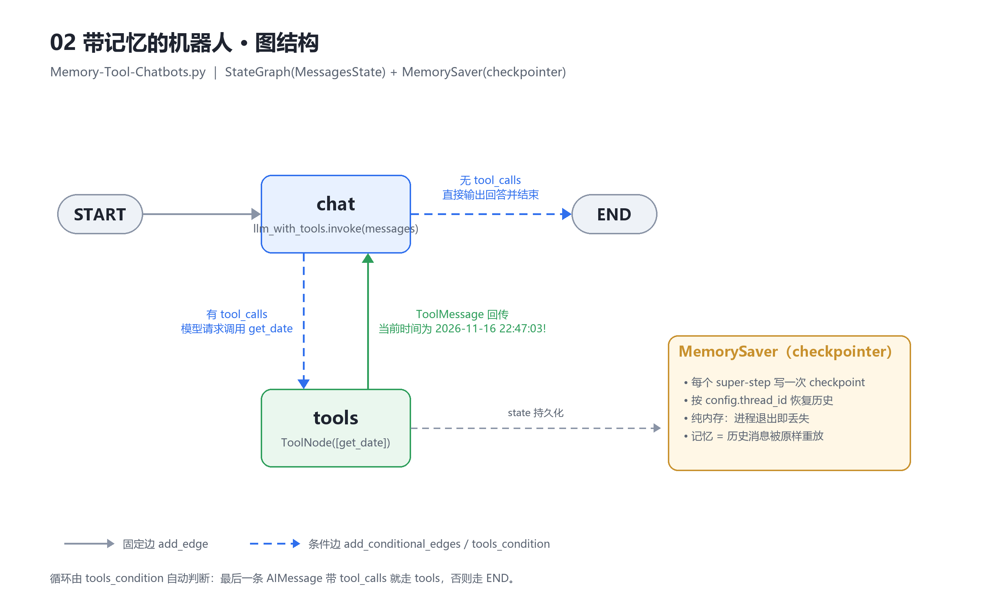
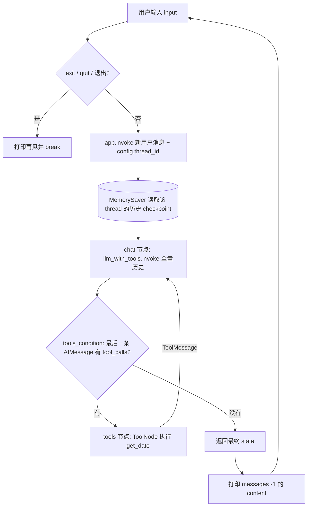

# 02 带记忆的机器人 —— `Memory-Tool-Chatbots.py` 代码详解

> 本目录只有一份脚本：**`Memory-Tool-Chatbots.py`**（76 行）。
> 它在 `01基础聊天机器人` 的「一次性问答」图之上，补上了三件事：**多轮记忆（checkpoint）**、**工具调用（ReAct）**、**对话循环（CLI）**。
>
> 一句话概括：**用 `MessagesState` 保存消息、用 `MemorySaver` 按 `thread_id` 存档、用 `ToolNode` + `tools_condition` 跑「思考—行动」循环，从而得到一个能记住你名字、还能查当前时间的命令行聊天机器人。**

---

## 目录

- [1. 从「无记忆」到「有记忆」：这份脚本补了什么](#1-从无记忆到有记忆这份脚本补了什么)
- [2. 运行方式](#2-运行方式)
- [3. 整体架构](#3-整体架构)
- [4. 代码逐段精讲](#4-代码逐段精讲)
- [5. 一次「现在几点钟」的运行轨迹](#5-一次现在几点钟的运行轨迹)
- [6. 记忆究竟存在哪里（checkpoint 机制）](#6-记忆究竟存在哪里checkpoint-机制)
- [7. 案例演示：完整对话与逐轮解析](#7-案例演示完整对话与逐轮解析)
- [8. 关键 API 速查表](#8-关键-api-速查表)
- [9. 常见坑与排错](#9-常见坑与排错)
- [10. 进阶改造练习](#10-进阶改造练习)
- [11. 自检清单](#11-自检清单)

---

## 1. 从「无记忆」到「有记忆」：这份脚本补了什么

先看 `01基础聊天机器人/basic-chatbot.py` 的图：`START → chatbot → END`，一条直线。

每次调用 `graph.stream(...)` 都是一张「新白纸」，只有本次输入，没有上次对话，且不能调用工具。

`02` 的脚本把图改成了带环的形状，并挂上存档器。两张图对比一下形状的变化：



*图 1 ｜ [`graph-compare.png`](./graph-compare.png)：上半是 01 的单向图，下半是 02 的循环图*

- **上面**：`01` 是一条直线，`START → chatbot → END`，图里没有环，也就没有「想一想再调用工具」的余地。
- **下面**：`02` 多了两条边 —— 一条条件边（chat → tools）和一条**回边**（tools → chat），环就是这么来的；右侧的 `MemorySaver` 负责跨轮保存历史。

| 能力 | 实现手段 |
|---|---|
| 记住上一轮说了什么 | `MemorySaver()` 作为 checkpointer + 固定的 `thread_id` |
| 状态里能累积多条消息 | `MessagesState`（`messages` 字段带 `add_messages` reducer） |
| 模型能主动查实时信息 | `llm.bind_tools([get_date])` + `ToolNode` |
| 自动决定「要不要调工具」 | `tools_condition` 条件边 |
| 调完工具再继续回答 | `add_edge("tools", "chat")` 回边 |
| 连续对话 | `while True` + `input()` 主循环 |

注意一个**名不副实的细节**：脚本打印的标题是「智能对话机器人（支持记忆和搜索）」，但 `TavilySearch` 相关的 3 行代码被注释掉了（第 3、24、26 行），实际注册的工具只有 `get_date` 一个。所以「搜索」这项能力在这份代码里**并未启用**，要启用请看 [第 10 节](#10-进阶改造练习)。

---

## 2. 运行方式

### 2.1 依赖

```bash
# 仓库根目录
pip install -r requirements.txt
```

本脚本真正用到的包只有 4 个：`langchain-openai`、`langgraph`、`python-dotenv`、`langchain-core`（随 `langchain` 一起装）。`langchain-tavily` 只有取消注释搜索工具时才需要。

### 2.2 环境变量

根目录 `.env`（`.env.example` 里有模板）：

```ini
deepseek_API_KEY=sk-xxxxxxxxxxxxxxxx
```

脚本第 12 行 `os.getenv("deepseek_API_KEY")` 读的就是它。**变量名大小写必须一致**（注意这里是小写 `deepseek`），写错会得到 `api_key must be set` 之类的报错。

### 2.3 启动

```bash
python "02带记忆的机器人/Memory-Tool-Chatbots.py"
```

- 在**仓库根目录**执行最省事：`load_dotenv()` 会自动向上查找并加载根目录的 `.env`。
- 退出方式：输入 `exit`、`quit`、`退出`，或按 `Ctrl+C`。
- 空行会被跳过，不会报错。

> Windows 用户若看到 emoji 打印异常（`UnicodeEncodeError`/乱码），先执行 `chcp 65001` 或设置 `set PYTHONIOENCODING=utf-8`。该异常会被第 71 行的 `except Exception` 捕获成「出错：...」，不会中断程序。

---

## 3. 整体架构

`Memory-Tool-Chatbots.py` 编译出来的图长这样（**静态图结构**）：



*图 2 ｜ [`graph-structure.png`](./graph-structure.png)：脚本编译出的图结构（实线＝固定边 `add_edge`，虚线＝条件边 `add_conditional_edges`）*

看这张图抓四个要点：

1. **两个节点**：`chat`（大脑）和 `tools`（手脚）；`START` / `END` 是 LangGraph 的入口与终点。
2. **两条条件边**：都从 `chat` 出发，由 `tools_condition` 判断 —— 有 `tool_calls` 走 `tools`，没有就去 `END`。
3. **一条回边**：`tools → chat`，把工具结果送回去让模型再组织语言，ReAct 循环就是靠这条边形成的。
4. **一个存档器**：`MemorySaver` 挂在 `compile(checkpointer=...)` 上，按 `thread_id` 存取状态，这就是「记忆」。

三个角色分工：

| 组件 | 角色 |
|---|---|
| `chat` 节点 | 「大脑」：拿着完整历史调模型，决定**直接回答**还是**要求调工具** |
| `tools` 节点 | 「手脚」：把模型请求的工具调用真正执行掉，把结果作为 `ToolMessage` 塞回消息列表 |
| `MemorySaver` | 「记事本」：每走完一个 super-step 就把状态存一份，下次同 `thread_id` 自动取回 |

### 3.1 运行时数据流

把上面那张「形状图」按时间顺序展开，就是用户每一次输入的完整流转：



一句话对照两张图：**形状图**回答「有哪些节点、边怎么连」，**数据流图**回答「一次输入依次经过谁」。中间的循环（`chat ↔ tools`）在形状图里表现为回边，在数据流图里表现为同一节点被反复访问。

---

## 4. 代码逐段精讲

### 4.1 导入（第 1–7 行）

```python
from dotenv import load_dotenv
from langchain_openai import ChatOpenAI
# from langchain_tavily import TavilySearch
from langgraph.graph import MessagesState, StateGraph, END
from langgraph.checkpoint.memory import MemorySaver
from langgraph.prebuilt import ToolNode, tools_condition
import os
```

- `MessagesState`：LangGraph 内置的对话状态类，等价于

  ```python
  class MessagesState(TypedDict):
      messages: Annotated[list[AnyMessage], add_messages]
  ```

  即「只有一个 `messages` 字段，且新消息**追加**而不是覆盖」。
- `END`：图终止节点常量（值为 `"__end__"`）。本次导入后在代码里没被显式使用，属于残留导入（`tools_condition` 内部返回的就是 `END`，属于隐式使用）。
- `MemorySaver`：内存版 checkpointer，`InMemorySaver` 的别名。
- `ToolNode`：预置节点，负责「解析 AIMessage.tool_calls → 执行 → 生成 ToolMessage」。
- `tools_condition`：预置路由函数，负责「有工具调用就走 tools，否则结束」。

### 4.2 构造模型客户端（第 9–15 行）

```python
load_dotenv()
llm = ChatOpenAI(
    model="deepseek-v4.1-flash-1017",
    api_key=os.getenv("deepseek_API_KEY"),  # 从 .env 读取
    base_url="https://tokenrhythm.studio/v1",
    temperature=0.7
)
```

- `ChatOpenAI` 走的是 **OpenAI 兼容协议**（`/v1/chat/completions`），所以只要网关兼容，`model` 和 `base_url` 就可以随便指向 DeepSeek 官方、中转网关、vLLM、Ollama 等。
- 密钥**不写死**，从 `.env` 注入 —— 这也是仓库 `README.md` 里再三强调的密钥安全约定。
- `temperature=0.7`：偏发散，回答里会带 emoji、「记得早点休息哦～」这类拟人化表达，与演示效果一致。若要结果可复现，可改 0（`01` 的脚本就是 0）。
- ⚠️ 本脚本读取的变量名是 `deepseek_API_KEY`（小写 `deepseek`，不是 `DASHSCOPE_API_KEY`），改模型或网关时别忘了同步检查这里。

### 4.3 定义工具（第 17–22 行）

```python
def get_date(local_date: str) -> str:
    """获取当前时间"""
    import time
    local_time = time.localtime()
    local_date=time.strftime("%Y-%m-%d %H:%M:%S", local_time)
    return f"当前时间为 {local_date}!"
```

这段有 3 个值得说的点：

1. **函数签名和 docstring 会被转成 JSON Schema 发给模型**。模型看到的「工具说明书」大致是：

   ```json
   {
     "name": "get_date",
     "description": "获取当前时间",
     "parameters": {
       "type": "object",
       "properties": {"local_date": {"type": "string"}},
       "required": ["local_date"]
     }
   }
   ```

   所以 **docstring 要写清楚「这个工具干什么」**，模型主要靠它判断该不该调。

2. **`local_date` 这个参数其实是多余的坑**。函数体第一行就把形参覆盖掉了，真实时间来自 `time.localtime()`；但因为是**必填参数**，模型被迫自己编一个字符串塞进来（常见是它自己猜的日期或空串）。功能上能跑，语义上别扭。更干净的写法是 `def get_date() -> str:`（见 [第 10 节](#10-进阶改造练习)）。

3. `time` 在函数内部 import，是「用到才引入」的局部优化，不影响功能。

### 4.4 注册工具（第 24–28 行）

```python
# search_tool = TavilySearch(max_results=2)
# tools = [search_tool, get_date]
tools = [get_date]
llm_with_tools = llm.bind_tools(tools)
```

- `bind_tools` 把上面的 schema 绑定到模型请求里：之后每次 invoke 都会带上 `tools=[...]` 参数，模型**有可能**返回 `AIMessage.tool_calls` 而不是纯文本。
- 被注释掉的两行说明这份代码的「完整形态」是**搜索 + 时间**双工具；现在只保留了时间工具，所以标题里的「搜索」没有实际支撑。
- 想启用搜索：取消注释、`pip install langchain-tavily`、在 `.env` 补 `TAVILY_API_KEY=...` 即可，图结构不用改（`ToolNode` 和 `tools_condition` 对工具数量无感）。

### 4.5 状态定义（第 29 行）

```python
state = MessagesState
```

- 直接复用内置状态类，**不用**像 `01` 那样手写 `TypedDict` + `add_messages`。
- 注意这里是「类」而不是「实例」，`StateGraph` 接受 schema 类本身。
- `MessagesState` 的 reducer 是 `add_messages`，它做两件事：① 新消息按顺序追加；② 若消息带相同 `id` 则**替换**旧消息（用于消息编辑、重新生成等场景）。

### 4.6 建图（第 31–38 行）

```python
workflow = StateGraph(state)
workflow.add_node("chat", lambda state: {"messages": llm_with_tools.invoke(state["messages"])})
workflow.add_node("tools", ToolNode(tools=tools))
workflow.add_conditional_edges("chat", tools_condition)
workflow.add_edge("tools", "chat")
workflow.set_entry_point("chat")
```

逐行拆：

| 代码 | 作用 |
|---|---|
| `StateGraph(state)` | 创建状态图，声明状态 schema |
| `add_node("chat", lambda ...)` | 节点函数接收当前状态、返回**状态增量**。这里把 `state["messages"]`（完整历史，含 checkpointer 恢复的部分）交给模型，返回 `{"messages": AIMessage}`，由 reducer 追加进历史 |
| `add_node("tools", ToolNode(tools=tools))` | 把工具列表交给预置节点，它会读取最后一条 AIMessage 的 `tool_calls`，逐个调用真实 Python 函数，并为每个调用生成一条 `ToolMessage` |
| `add_conditional_edges("chat", tools_condition)` | **没有传 path_map** 时，路由函数返回的字符串直接当目标节点名。`tools_condition` 的返回值只有两种：有 `tool_calls` → `"tools"`；没有 → `END`（`"__end__"`）。这一行同时完成了「去 tools」和「去终点」两条分支 |
| `add_edge("tools", "chat")` | **回边**，构成 ReAct 循环：工具执行完把结果交回模型，让它基于真实数据再组织语言 |
| `set_entry_point("chat")` | 等价于 `add_edge(START, "chat")` |

> 💡 **为什么必须有回边？** 没有它，图会在 `tools` 节点执行完就结束，用户只会看到一句工具原始返回值，拿不到模型加工后的自然语言回答。
>
> 💡 **会不会死循环？** 一般不会。循环由模型是否持续发起 `tool_calls` 决定；正常一次工具调用后模型会转为输出文本，`tools_condition` 就把它送去 `END`。要更保险可传 `recursion_limit`（如 `config={"recursion_limit": 20, ...}`）。

### 4.7 编译并挂上记忆（第 40–41 行）

```python
memory = MemorySaver()
app = workflow.compile(checkpointer=memory)
```

- `compile(checkpointer=...)` 让图「**每执行完一个 super-step 就写一次档**」。
- `MemorySaver` 把 checkpoint 存在**进程内存**里（字典），键是 `thread_id`。所以：
  - 同一个 `thread_id` → 能续上历史；
  - 换一个 `thread_id` → 全新对话；
  - **进程退出 → 记忆全部丢失**（要持久化见 [第 10 节](#10-进阶改造练习)）。
- 这也是「记忆」和「模型上下文窗口」的区别：模型本身无状态，记忆完全由我们把它上次的消息再喂回去实现。

### 4.8 对话主循环（第 44–75 行）

```python
def chat_with_memory():
    print("智能对话机器人（支持记忆和搜索）")
    print("输入 exit 退出对话")
    thread_id = "user_session_1"
    config = {"configurable": {"thread_id": thread_id}}
    while True:
        try:
            user_input = input("\n你：").strip()
            if not user_input:
                continue
            if user_input.lower() in ["exit", "quit", "退出"]:
                print("机器人：再见！")
                break

            result = app.invoke(
                {"messages": [("user", user_input)]},
                config=config
            )

            if result["messages"]:
                last_message = result["messages"][-1]
                print("机器人：", last_message.content)

        except KeyboardInterrupt:
            print("\n对话已结束")
            break
        except Exception as e:
            print(f"出错：{str(e)}")
```

关键点：

1. **`thread_id` 是记忆的钥匙**。这里硬编码成 `"user_session_1"`，意味着「这个程序永远只有一个用户」。做多用户时要按人分配（如 `f"user_{user_id}"`）。`config` 必须每次 invoke 都传，checkpointer 靠它定位存档。
2. **每次只传「这一轮的新输入」**，不传历史。历史是 checkpointer 从 checkpoint 恢复、再由 `add_messages` 与本次输入合并的 —— 这正是有记忆机器人写法简洁的原因。
3. `[("user", user_input)]` 是 LangChain 的**元组简写**，等价于 `[HumanMessage(content=user_input)]`。
4. `result["messages"][-1]` 是走完整个循环（可能经历若干次 chat/tools 往返）后的**最后一条消息**，通常是模型最终的自然语言回答；`result` 里也包含完整历史，可用于调试。
5. 异常处理分两层：`KeyboardInterrupt` 正常收尾；其他异常打印后**继续循环**（不退出）。好处是对话不中断，坏处是配置错误（如密钥失效）会一直刷「出错：...」，排查时建议临时 `traceback.print_exc()`。
6. `if __name__ == "__main__":` 保证被 import 时不会自动开跑。

---

## 5. 一次「现在几点钟」的运行轨迹

假设此刻已聊过「我叫小旺」，用户输入 **「现在几点钟」**。图内部的消息流转如下：

**第 1 个 super-step：`chat`**

- 从 checkpoint 恢复出历史：`[HumanMessage("我叫小旺"), AIMessage("你好，小旺！...")]`
- 追加本次输入 → 发给模型（携带 `get_date` 的 schema）
- 模型返回：

  ```python
  AIMessage(
      content="",
      tool_calls=[{
          "name": "get_date",
          "args": {"local_date": "2026-11-16"},
          "id": "call_abc123",
          "type": "tool_call"
      }]
  )
  ```

**第 2 个 super-step：`tools`**

- `ToolNode` 解析 `tool_calls`，调用 `get_date(**{"local_date": "2026-11-16"})`
- 函数内部忽略形参，用 `time.localtime()` 取真实时间 → `"当前时间为 2026-11-16 22:47:03!"`
- 生成 `ToolMessage(content="当前时间为 2026-11-16 22:47:03!", tool_call_id="call_abc123")` 追加进历史

**第 3 个 super-step：回到 `chat`**

- 模型看到工具返回的真实时间，组织成自然语言：

  ```python
  AIMessage(content="现在是 **2026年11月16日 晚上 22:47** 🕙\n\n夜深了，小旺记得早点休息哦～")
  ```

**第 4 步：`tools_condition`**

- 最后一条 AIMessage 没有 `tool_calls` → 返回 `END`，图结束，`invoke` 返回完整 state，脚本打印 `content`。

> 注意这中间**没有任何一行代码**是我们写的「判断要不要查时间」——全部由模型依据 `get_date` 的 description 自主决定，这就是 ReAct（Reason + Act）模式。

---

## 6. 记忆究竟存在哪里（checkpoint 机制）

`MemorySaver` 在每个 super-step 结束后写档。以上面的例子，同一个 `thread_id` 下依次产生：

| checkpoint 序号 | 写档时机 | `messages` 里的内容 |
|---|---|---|
| `n+0` | 本轮 invoke 开始前（上一轮结束时的状态） | `[Human("我叫小旺"), AI("你好，小旺！...")]` |
| `n+1` | `chat` 执行完 | 追加 `AI(tool_calls=[get_date])` |
| `n+2` | `tools` 执行完 | 追加 `Tool(当前时间为 ...)` |
| `n+3` | 再次 `chat` 执行完 | 追加 `AI("现在是 2026年11月16日 晚上 22:47 ...")` |

下一次 `invoke` 时，图会拿 `config["configurable"]["thread_id"]` 去 `MemorySaver` 里取**最新 checkpoint**，把 `messages` 恢复回来，所以你只传一条新消息也能「接着聊」。

三个容易混淆的点：

- **记忆 ≠ 模型记住**：模型每次都是无状态调用，是我们在消息列表里「重放」历史。
- **记忆 ≠ 数据库**：`MemorySaver` 是纯内存的，关掉程序就没了。
- **记忆按 thread 隔离**：`thread_id` 不同 = 两个互不可见的平行世界。这一点也很适合做「一个真实用户一个 thread」的多会话管理。

---

## 7. 案例演示：完整对话与逐轮解析

### 7.1 实际运行效果

```text
智能对话机器人（支持记忆和搜索）
输入 exit 退出对话

你：我叫小旺
机器人： 你好，小旺！很高兴认识你 😊

有什么我可以帮你的吗？

你：现在几点钟
机器人： 现在是 **2026年11月16日 晚上 22:47** 🕙

夜深了，小旺记得早点休息哦～

你：我叫什么
机器人： 你叫 **小旺** 😊 刚才你告诉我的，我记得呢～

你：exit
机器人：再见！
```

### 7.2 逐轮解析

| 轮次 | 用户输入 | 图内部发生了什么 | 关键机制 |
|---|---|---|---|
| 1 | 我叫小旺 | `chat` 直接产出文本，无工具调用 → `END`；状态存入 checkpoint | 建立第一条历史 |
| 2 | 现在几点钟 | `chat` 请求 `get_date` → `tools` 执行 → 回到 `chat` 生成回答 | **ReAct 循环**：模型自主判断「时间类问题必须取实时数据」 |
| 3 | 我叫什么 | `chat` 直接回答，但消息列表里已有第 1 轮的「我叫小旺」 | **记忆**：模型从历史中检索事实，无需任何显式「记忆库」 |
| 4 | exit | 命中断词表，不进图，直接打印再见并 `break` | **主循环控制** |

### 7.3 三个值得观察的细节

**① 第 2 轮为什么必须有工具？**
大模型训练数据有截止时间，它「不知道现在几点」。若没有 `get_date`，它要么拒答，要么**编一个时间**（幻觉）。工具调用的本质是：把模型不确定的事实性数据交给确定性的程序去取。

**② 第 3 轮为什么能记住名字？**
不是模型有记忆，而是第 3 轮发给模型的 `messages` 里**原封不动包含了前几轮的全部消息**：

```text
Human("我叫小旺")
AI("你好，小旺！...")
Human("现在几点钟")
AI(tool_calls=[get_date])
Tool("当前时间为 2026-11-16 22:47:03!")
AI("现在是 2026年11月16日 晚上 22:47 🕙 ...")
Human("我叫什么")          ← 本次新输入
```

所以它能「看见」第一句话。可以做个验证实验：把 `thread_id` 改成 `"user_session_2"` 再问「我叫什么」，它会答不知道 —— **因为换了一个空存档**。

**③ 语气为什么这么「像人」？**
`temperature=0.7` + 历史里模型自己用过 emoji 和亲切口吻，后续回复会沿袭这个风格；同时模型把第 1 轮拿到的名字用在了第 2 轮的回答里（「小旺记得早点休息哦」），这是**跨轮信息复用**的直观体现。

---

## 8. 关键 API 速查表

| API | 所属 | 说明 |
|---|---|---|
| `MessagesState` | `langgraph.graph` | 内置对话状态，`messages` 使用 `add_messages` reducer |
| `StateGraph(schema)` | `langgraph.graph` | 状态图构造器 |
| `add_node(name, fn)` | `StateGraph` | 注册节点；`fn(state) -> dict` 返回状态增量 |
| `add_edge(src, dst)` | `StateGraph` | 固定边（`tools -> chat` 构成循环） |
| `add_conditional_edges(src, fn)` | `StateGraph` | 动态路由；未给 path_map 时返回值即目标节点名 |
| `set_entry_point(name)` | `StateGraph` | 等价 `add_edge(START, name)` |
| `compile(checkpointer=...)` | `StateGraph` | 编译为可执行图；传入 checkpointer 才会持久化状态 |
| `MemorySaver` / `InMemorySaver` | `langgraph.checkpoint.memory` | 内存存档，进程结束即失效 |
| `ToolNode(tools=[...])` | `langgraph.prebuilt` | 执行 `tool_calls` 并产出 `ToolMessage` |
| `tools_condition(state)` | `langgraph.prebuilt` | 有 `tool_calls` → `"tools"`，否则 → `END` |
| `llm.bind_tools([...])` | `BaseChatModel` | 把工具 schema 绑进请求 |
| `app.invoke(input, config)` | 编译后的图 | 阻塞执行到结束，返回最终 state |
| `{"configurable": {"thread_id": ...}}` | — | checkpoint 定位键，记忆隔离的依据 |

---

## 9. 常见坑与排错

| 现象 | 原因 | 处理 |
|---|---|---|
| `api_key must be set` / `AuthenticationError` | `.env` 缺失、变量名写错、或从别的目录运行导致找不到 `.env` | 在仓库根目录运行；确认变量名是 `deepseek_API_KEY` |
| 每次都「你是谁」式的失忆 | `thread_id` 每次都变了，或没传 `config` | 保持同一 `thread_id`，并确保 `invoke` 带 `config` |
| 重启程序后记忆清空 | `MemorySaver` 是内存存储 | 换 `SqliteSaver` / `PostgresSaver`（见第 10 节） |
| 报 `get_date() missing 1 required argument` | 模型生成的 `tool_calls.args` 里缺 `local_date` | 把函数改成无参 `def get_date() -> str:` |
| 控制台中文/emoji 乱码或 `UnicodeEncodeError` | Windows 默认 GBK 代码页 | `chcp 65001`，或设 `PYTHONIOENCODING=utf-8` |
| 回答里时间日期是编的 | 模型没触发工具调用（description 不够明确、或提示词模糊） | 强化 docstring，例如「查询本机当前真实日期与时间，凡涉及『现在/今天/几点』的提问都应调用」 |
| 一直「出错：...」却不退出 | `except Exception` 吞掉异常后继续循环 | 临时加 `import traceback; traceback.print_exc()` 定位 |
| 长对话越来越慢/超上下文 | 历史无限增长，每轮都全量回放 | 做消息裁剪、摘要压缩，或限制最近 N 轮 |
| 回答风格飘忽、测试不可复现 | `temperature=0.7` | 调试期改 0（`01` 脚本即如此） |
| 标题说「支持搜索」但不会搜索 | Tavily 相关代码被注释 | 取消第 3/24/26 行注释并装 `langchain-tavily` |

---

## 10. 进阶改造练习

按难度排序，每条都可独立完成：

1. **修掉冗余参数**（1 行）

   ```python
   def get_date() -> str:
       """获取当前真实日期与时间，涉及『现在几点/今天几号』的问题都应调用本工具"""
       import time
       return f"当前时间为 {time.strftime('%Y-%m-%d %H:%M:%S', time.localtime())}!"
   ```

2. **让记忆落盘**（换持久化 checkpointer）

   ```python
   # pip install langgraph-checkpoint-sqlite
   from langgraph.checkpoint.sqlite import SqliteSaver
   memory = SqliteSaver.from_conn_string("checkpoints.sqlite")
   app = workflow.compile(checkpointer=memory)
   ```

   这样关掉程序再启动，同一 `thread_id` 仍能续聊。

3. **支持多用户**

   ```python
   user_id = input("请输入用户名：")
   config = {"configurable": {"thread_id": f"user_{user_id}"}}
   ```

4. **启用 Tavily 搜索**：取消注释 → `pip install langchain-tavily` → `.env` 加 `TAVILY_API_KEY` → `tools = [search_tool, get_date]`。图结构零改动，这就是 `ToolNode` 的扩展性。

5. **流式输出**：把 `app.invoke` 换成 `for chunk in app.stream(..., stream_mode="messages")`，边生成边打印。

6. **加系统提示词**：在 `chat` 节点里前置一条 `SystemMessage("你是小旺的私人助理，回答简洁亲切")`，稳定人设。

7. **给循环加保险**：`app.invoke(..., config={**config, "recursion_limit": 20})`，防止模型反复调工具时无限循环。

---

## 11. 自检清单

读完/跑完这份脚本，应能回答：

- [ ] `MessagesState` 和手写 `TypedDict + add_messages` 是什么关系？
- [ ] `add_conditional_edges("chat", tools_condition)` 为什么不用写 path_map？
- [ ] `add_edge("tools", "chat")` 这条回边删掉会怎样？（答：只会打印工具原始返回值）
- [ ] `thread_id` 在记忆机制里起什么作用？改掉它会怎样？
- [ ] 为什么每次 `invoke` 只传一条新消息，模型却知道完整历史？
- [ ] 为什么「现在几点钟」必须走工具，而「我叫什么」不用？
- [ ] `MemorySaver` 的记忆什么时候会丢？换成什么可以持久化？

---

> 相关文档：仓库根目录 [`README.md`](../README.md) ｜ 前置示例 [`01基础聊天机器人/basic-chatbot.py`](../01基础聊天机器人/basic-chatbot.py)
>
> 文中两张示意图（`graph-compare.png`、`graph-structure.png`）与本文件同目录，可直接打开查看。
