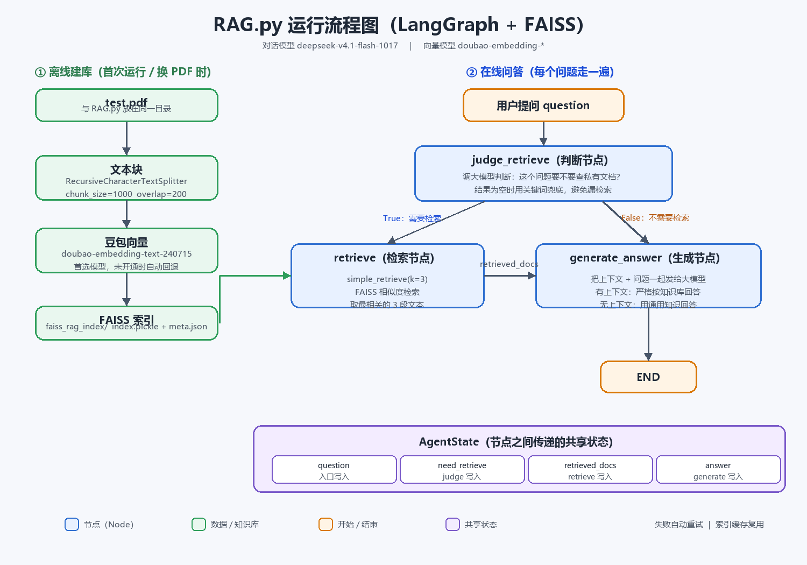

# RAG.py 代码详解

> 对应文件：[RAG.py](RAG.py)（921 行，逐行中文注释）
> 本文说明：这个脚本长什么样、每一步为什么这么写、怎么改、出错了怎么查。
> 文中所有命令都在 `03RAG检索` 目录下执行，`python` 指已装好依赖的解释器（脚本启动时会自检并提示）。

---

## 一、这个脚本做什么

一句话：**把 PDF 变成可检索的知识库，用户提问时先判断要不要查，要查就检索相关段落，再把段落塞进提示词让大模型回答。**

### 1.1 运行流程图



> 上图由脚本的实际流程绘制：左边是「离线建库」，右边是「在线问答」，底部是节点间共享的 `AgentState`。

### 1.2 三条数据流

```text
① 建库（离线，一次）       PDF --PyPDFLoader--> 每页 Document
                              --RecursiveCharacterTextSplitter--> 文本块
                              --豆包向量模型--> 向量
                              --FAISS--> 索引（落盘 index.pickle + meta.json）

② 问答（在线，每个问题）   问题 --judge_retrieve--> 需要检索吗？
                              ├─ 否 -> generate_answer（用通用知识答）
                              └─ 是 -> retrieve（FAISS 取 top-k 段）-> generate_answer
                           最终 answer 返回

③ 配置（启动时）            .env --load_dotenv--> 环境变量 --_env--> 模型/Key/参数
```

### 1.3 图结构

```text
        ┌──────────────────┐
        │  judge_retrieve  │  （节点 1：判断要不要检索）
        └────────┬─────────┘
                 │ 条件边 route_after_judge
        ┌────────┴─────────┐
        │ need_retrieve    │
        ▼                  ▼
 ┌────────────┐     ┌──────────────────┐
 │  retrieve  │     │  generate_answer │
 └─────┬──────┘     └────────┬─────────┘
       │  普通边              │
       └──────────────────────┘
                              ▼
                             END
```

---

## 二、文件结构总览

| 行号 | 段落 | 作用 |
|------|------|------|
| 1~22 | 文档字符串 | 用法说明、模型配置、命令行参数 |
| 28~112 | **步骤 0** 环境兜底 | 控制台编码修复、依赖检查（缺依赖时打印可复制的安装命令） |
| 113~192 | **步骤 1** 路径与配置 | `.env` 加载、多 Key 兼容、模型地址/名称、切分参数、测试问题、脱敏函数 |
| 193~310 | **步骤 2** 大模型 | [ChatModel](RAG.py#L195)（真实，带重试）、[MockChatModel](RAG.py#L259)（离线假模型）、`build_llm` |
| 311~529 | **步骤 3** 向量模型 | [ArkEmbeddings](RAG.py#L317)（方舟两套接口自动探测）、[MockEmbeddings](RAG.py#L492)、`build_embeddings` |
| 530~681 | **步骤 4** 私有知识库 | [find_pdf](RAG.py#L532)、指纹与缓存校验、中文路径安全的保存/读取、建库、[simple_retrieve](RAG.py#L669) |
| 682~766 | **步骤 5** 状态与节点 | [AgentState](RAG.py#L684)、判断/检索/生成三个节点、路由函数、[build_agent](RAG.py#L691) |
| 767~921 | **步骤 6** 运行与测试 | [run_rag_agent](RAG.py#L769)、[run_doctor](RAG.py#L781)、`parse_args`、[main](RAG.py#L868) |

---

## 三、步骤 0：环境兜底（28~112 行）

**为什么一上来的代码不是 import，而是先处理环境？**

### 3.1 控制台编码

Windows 中文控制台的默认编码是 `gbk`，脚本里有 `✅ 📄 🔍` 这类 emoji，直接 `print` 会抛：

```text
UnicodeEncodeError: 'gbk' codec can't encode character '\u2705'
```

所以先执行：

```python
def _fix_console_encoding() -> None:
    for stream_name in ("stdout", "stderr"):
        stream = getattr(sys, stream_name, None)
        if stream is None:
            continue
        try:
            stream.reconfigure(errors="replace")  # 保留原编码，只放宽错误处理
        except Exception:
            pass
```

关键点：**只改 `errors`，不改 `encoding`**。这样中文照常显示（gbk 支持中文），只有 emoji 这种编码不了的字符退化成 `?`，不会让脚本崩掉。

### 3.2 依赖检查

```python
_REQUIRED_IMPORTS = {
    "dotenv": "python-dotenv",
    "openai": "openai",
    "httpx": "httpx",
    "langchain_community": "langchain-community",
    "langchain_core": "langchain-core",
    "langchain_text_splitters": "langchain-text-splitters",
    "langgraph": "langgraph",
    "faiss": "faiss-cpu",
}
```

模块名和 pip 包名经常不一样（`faiss` ↔ `faiss-cpu`），所以要做一张映射表。缺失时**不抛 ImportError**，而是打印：

```text
❌ 缺少依赖：faiss-cpu
   当前解释器：<你正在用的 python 路径>
   方式一：装到当前解释器（复制这一行执行）
   "<你的 python>" -m pip install --index-url https://mirrors.aliyun.com/pypi/simple --trusted-host mirrors.aliyun.com faiss-cpu
   方式二：或改用另一个已装齐依赖的解释器运行 RAG.py
```

要点：**「当前解释器」+「可直接复制的安装命令」**，避免出现「明明装了却跑不起来」的困惑（不同解释器装的包不互通）。

---

## 四、步骤 1：路径与配置（113~192 行）

### 4.1 路径

```python
SCRIPT_DIR = Path(__file__).resolve().parent                 # 脚本所在目录
DEFAULT_INDEX_DIR = SCRIPT_DIR / "faiss_rag_index"            # 真实模型索引
MOCK_INDEX_DIR = SCRIPT_DIR / "faiss_rag_index_mock"          # 模拟模式索引
```

用 `Path(__file__).resolve()` 而不是相对路径，**脚本在任何工作目录下运行，索引和 PDF 都落在正确位置**。
真实 / 模拟两套索引目录分开，因为两者向量维度不同（2048 vs 256），混在一起会检索出错。

### 4.2 `.env` 加载

脚本启动时会自动加载 `.env`，规则是：**本章目录的 `.env` 优先级最高**，同名配置会覆盖系统环境变量里已有的值，
这样本章可以单独调模型和参数，不改代码、不动系统环境。

### 4.3 `_env()`：多 Key 名兼容

```python
def _env(*names: str, default: Optional[str] = None) -> Optional[str]:
    for name in names:
        value = os.getenv(name)
        if value and value.strip():
            return value.strip()
    return default
```

Key 的名字不同项目写法五花八门（`LLM_API_KEY`、`deepseek_API_KEY`、`DEEPSEEK_API_KEY`、`OPENAI_API_KEY`…），
这个函数按优先级取第一个非空值，避免「明明配了 Key 却读不到」。

### 4.4 配置项一览

| 变量 | 默认值 | 说明 |
|------|--------|------|
| `LLM_BASE_URL` | `https://tokenrhythm.studio/v1` | 大模型网关地址 |
| `LLM_MODEL` | `deepseek-v4.1-flash-1017` | 大模型名称 |
| `LLM_API_KEY` 等 | — | 大模型密钥（多个别名） |
| `ARK_BASE_URL` | `https://ark.cn-beijing.volces.com/api/v3` | 方舟接口 |
| `ARK_API_KEY` | — | 方舟密钥 |
| `EMBEDDING_MODEL` | `doubao-embedding-text-240715` | 首选向量模型 |
| `EMBEDDING_FALLBACKS` | `doubao-embedding-large-text-250515,doubao-embedding-vision-251215` | 备用向量模型 |
| `EMBEDDING_BATCH_SIZE` | `10` | 文本向量每批条数 |
| `CHUNK_SIZE` / `CHUNK_OVERLAP` | `1000` / `200` | 文本块大小 / 重叠字符数 |

### 4.5 测试案例与兜底常量

```python
TEST_QUESTIONS = [
    "这份文档主要讲了什么？",          # 需要检索：文档主题
    "大会在什么时间、什么地点举办？",  # 需要检索：文档细节
    "Python 是什么类型的编程语言？",   # 不需要检索：通用知识（测试案例 2）
    "LangGraph 的核心组件有哪些？",    # 测试案例 1
]
PRIVATE_DOC_KEYWORDS = ("文档", "本文", "报告", "PDF", ...)  # 判断节点返回空时的兜底关键词
MOCK_CHUNKS = [...]  # 没有 PDF 时用的示例文本块
```

### 4.6 `mask()`：日志脱敏

```python
def mask(secret): return f"{secret[:6]}...{secret[-4:]}"
```

日志里只显示 Key 的头尾，避免把密钥打进控制台 / 日志文件。

---

## 五、步骤 2：大模型封装（193~310 行）

### 5.1 `ChatModel`：真实模型

本质是 OpenAI SDK 的薄封装，只做三件事：**拼 messages、发请求、失败重试**。

```python
self.client = OpenAI(api_key=api_key, base_url=self.base_url, timeout=timeout, max_retries=0)
```

注意 `max_retries=0`：SDK 自带的重试关掉，统一由 `_should_retry` 控制，日志清楚（能打印「第几次失败、等几秒」）。

```python
def invoke(self, prompt, *, temperature=0.1, system_prompt=None, max_tokens=None) -> str:
    messages = []
    if system_prompt:
        messages.append({"role": "system", "content": system_prompt})
    messages.append({"role": "user", "content": prompt})
    kwargs = {"model": self.model, "messages": messages, "temperature": temperature}
    if max_tokens:
        kwargs["max_tokens"] = max_tokens
    ...
```

重试策略：

| 情况 | 是否重试 |
|------|----------|
| HTTP 408/409/425/429/500/502/503/504 | ✅ 重试（1s、2s、4s 指数退避） |
| `APIConnectionError` / `APITimeoutError` / `RateLimitError` | ✅ 重试 |
| 401 / 403 / 404 / 400 | ❌ 直接报错（配置问题，重试没用） |

**最需要注意的一点：不要给判断节点限制 `max_tokens`。**
`deepseek-v4.1-flash-1017` 会先消耗 token 做「思考」，实测 `max_tokens=8/32/64` 时判断节点直接返回空字符串，
只有不限制才会返回 `True` / `False`。脚本里判断节点因此不传 `max_tokens`。

### 5.2 `MockChatModel`：离线假模型

没有 Key 或者加 `--mock` 时用它，不联网、按关键词返回固定答案。

```python
@staticmethod
def _question_of(prompt: str) -> str:
    marker = "问题："
    if marker in prompt:
        return prompt.rsplit(marker, 1)[1].strip()   # 取最后一段：真正的用户问题
    return prompt.strip()
```

**为什么要 `_question_of`？** 因为生成节点的提示词长这样：

```text
你是专业助手，请严格依据以下知识库内容回答问题……
知识库内容：
<检索到的段落，里面可能就带「大会」两个字>
问题：<用户真正的问题>
```

如果直接对整段提示词做关键词匹配，会命中知识库上下文里的词，导致所有问题都走到同一个分支。
`rsplit("问题：", 1)` 只取最后一段，才是用户问题。

### 5.3 `build_llm()`：按模式创建

```python
def build_llm(use_mock: bool):
    if use_mock:
        return MockChatModel()
    return ChatModel(LLM_API_KEY or "")
```

---

## 六、步骤 3：向量模型封装（311~529 行）

### 6.1 为什么这么复杂：方舟有两套向量接口

| 接口 | 路径 | 模型 | 一次几条 |
|------|------|------|----------|
| 文本向量 | `POST /embeddings` | `doubao-embedding-text-240715` 等 | 一批最多 10 条 |
| 多模态向量 | `POST /embeddings/multimodal` | `doubao-embedding-vision-251215` 等 | 一次 1 条 |

而且**当前方舟账号不一定开通了你想要的模型**（实测 `doubao-embedding-text-240715` 返回 404 未开通），
所以 `ArkEmbeddings` 的设计是：**按候选列表逐个探测，第一个能用的固定下来，之后所有请求都走它。**

### 6.2 探测流程 `ensure_active()`

```text
候选 = [EMBEDDING_MODEL] + EMBEDDING_FALLBACKS   # 默认 3 个
for 每个候选:
    判断接口模式：名字里有 vision -> multimodal，否则 text
    发一条「向量维度探测」请求
    ├─ 成功 -> 记录 active_model / active_mode / dimension，打印日志，结束
    └─ 失败 -> 记录失败原因，试下一个
全部失败 -> 抛 EmbeddingError，并打印每个候选的失败原因 + 排查步骤
```

成功时的日志：

```text
🧮 向量模型就绪：doubao-embedding-vision-251215｜模式=multimodal｜维度=2048（首选模型不可用，已自动回退）
```

### 6.3 底层 `_post()`：统一错误处理

```python
if response.status_code == 401:
    hint = "（ARK_API_KEY 无效，请检查火山方舟控制台的 API Key）"
elif code == "InvalidEndpointOrModel.NotFound":
    hint = "（当前方舟账号未开通该模型/没有访问权限）"
elif response.status_code == 400 and "not support this api" in message:
    hint = "（该模型不支持文本向量接口，需要走 /embeddings/multimodal）"
```

方舟的错误码（`InvalidEndpointOrModel.NotFound` 等）对新手不友好，这里翻译成人话。
限流 / 5xx 自动重试（1s、2s、4s、8s）。

### 6.4 `embed_documents` / `embed_query`

- `embed_documents`：建库时批量向量化。
  - text 模式：按 `batch_size` 分批，**按返回的 `index` 排序**保证顺序与输入一致（LangChain 的硬性要求）。
  - multimodal 模式：一次只能一条，逐条请求，每 10 条打印一次进度。
- `embed_query`：检索时把用户问题转成向量，复用单条逻辑。
- 异步版本 `aembed_documents` / `aembed_query` 直接复用同步实现，兼容 LangChain 的异步调用约定。

### 6.5 `MockEmbeddings`：本地哈希向量

```python
digest = hashlib.sha256(text.encode("utf-8")).digest()          # 32 字节
values = [b / 255.0 for b in digest]
return (values * (self.DIMENSION // len(values) + 1))[: self.DIMENSION]  # 铺满 256 维
```

同样的文本永远得到同样的向量，不需要联网、不需要 Key，FAISS 也能正常建索引和检索 —— 用来离线演示整条链路。

---

## 七、步骤 4：构建私有知识库（530~681 行）

### 7.1 找 PDF

```python
candidates = [SCRIPT_DIR / "test.pdf"]   # 与 RAG.py 放在同一目录
```

**PDF 固定放在脚本同级目录**：`03RAG检索/test.pdf`。
找不到就抛 `FileNotFoundError`，提示应该放在哪里。

### 7.2 索引缓存：`meta.json` + 指纹

`meta.json` 记录三件关键信息：

```json
{
  "pdf": {"name": "test.pdf", "size": 360042, "mtime": 1762415854},
  "embedding": {"model": "doubao-embedding-vision-251215", "mode": "multimodal", "dimension": 2048},
  "chunk_size": 1000,
  "chunk_overlap": 200,
  "chunks": 4,
  "created_at": "2026-11-17 22:25:54"
}
```

`_index_is_usable()` 依次对比：**PDF 指纹、向量模型标识、切分参数**。三者都没变才复用，否则重建。
这样换 PDF / 换向量模型 / 改 `CHUNK_SIZE` 会自动重建，不会拿旧索引检索新文档。

### 7.3 中文路径问题：为什么不用 `save_local`

```python
vector_store.save_local(".../03RAG检索/faiss_rag_index")
# RuntimeError: ... FileIOWriter ... could not open ...\faiss_rag_index\index.faiss for writing
```

faiss 在 Windows 上用 C 的 `fopen`，路径按 ANSI 编码走，目录名带中文（「03RAG检索」）就打不开。
**解决办法：绕开 faiss 的文件 IO。**

```python
def _save_store(vector_store, index_dir):
    index_dir.mkdir(parents=True, exist_ok=True)
    (index_dir / "index.pickle").write_bytes(vector_store.serialize_to_bytes())  # pickle 成 bytes

def _load_store(embeddings, index_dir):
    return FAISS.deserialize_from_bytes(
        (index_dir / "index.pickle").read_bytes(),
        embeddings,
        allow_dangerous_deserialization=True,
    )
```

`serialize_to_bytes()` 内部会把 `(index, docstore, index_to_docstore_id)` 一起 pickle，
再用 Python 的 `open` 写文件（Python 处理 Unicode 路径没问题）。

### 7.4 建库主流程 `build_or_load_index()`

```text
1. 真实向量模型先 ensure_active()（确定接口和维度）
2. 缓存可用？ -> 读缓存，打印「♻️ 复用…」，返回
3. PDF 不存在？ -> 用 MOCK_CHUNKS 走 FAISS.from_texts，落盘，返回（离线兜底）
4. PyPDFLoader 加载 PDF -> Document 列表（每页一个）
5. RecursiveCharacterTextSplitter 切块（chunk_size=1000, overlap=200）
6. FAISS.from_documents 批量向量化 + 建索引（计时）
7. _save_store 保存索引；写 meta.json
```

切分参数用 `separators=["\n\n", "\n", " ", ""]`：优先按段落切，其次换行、空格，最后才硬切字符，
这样尽量保证一个文本块语义完整。

### 7.5 `simple_retrieve()`：检索函数

```python
def simple_retrieve(vector_db, query, k=3, fallback_chunks=()):
    if vector_db is None:
        return list(fallback_chunks[:k]) or ["无可用文档"]
    try:
        docs = vector_db.similarity_search(query, k=k)
        return [doc.page_content for doc in docs]
    except Exception:
        return list(fallback_chunks[:k]) or ["无可用文档"]
```

**检索失败不让整条流程崩**，退化成兜底文本。
（LangChain 也有等价的 `vector_db.as_retriever(search_kwargs={"k": 3}).invoke(query)` 写法，脚本注释里也标了。）

---

## 八、步骤 5：状态与节点（682~766 行）

### 8.1 状态 `AgentState`

```python
class AgentState(TypedDict):
    question: str          # 用户原始问题（入口写入）
    retrieved_docs: List[str]  # 检索到的文本块（retrieve 节点写入）
    answer: str            # 最终回答（generate 节点写入）
    need_retrieve: bool    # 是否需要检索（judge 节点写入，路由函数读）
```

`TypedDict` 只是类型提示，运行时就是普通 dict。**LangGraph 的节点是「收状态、返回状态」的函数**，
新字段以 dict 合并的方式写回。

### 8.2 三个节点

| 节点 | 输入 | 做什么 | 输出 |
|------|------|--------|------|
| `judge_retrieve_node` | `question` | 让大模型判断「要不要查私有文档」，只答 True/False | `need_retrieve` |
| `retrieve_node` | `question` | `simple_retrieve` 取 top-k 段 | `retrieved_docs` |
| `generate_node` | `question` + `retrieved_docs` | 有上下文就严格按知识库答，没有就用通用知识答 | `answer` |

判断节点的两个细节：

```python
result = llm.invoke(prompt, temperature=0).strip().lower()   # 不限制 max_tokens
if result:
    state["need_retrieve"] = result.startswith("true")
else:
    # 模型返回空 -> 用关键词兜底，避免漏检索
    state["need_retrieve"] = any(key in question for key in PRIVATE_DOC_KEYWORDS)
```

- 温度 0：判断类任务要稳定。
- 不限制 `max_tokens`：原因见 5.1。
- 返回空用关键词兜底：宁可多检索，不要漏检索。

生成节点的提示词里明确写了：

```text
如果知识库中没有相关信息，请回答“根据知识库，暂无相关信息”。
```

这是抑制幻觉的关键 —— 文档里没有的内容，不允许模型瞎编。

### 8.3 建图六步

```python
workflow = StateGraph(AgentState)                      # 1. 创建状态图
workflow.add_node("judge_retrieve", judge_retrieve_node)  # 2. 添加节点
workflow.add_node("retrieve", retrieve_node)
workflow.add_node("generate_answer", generate_node)
workflow.set_entry_point("judge_retrieve")             # 3. 设置入口
workflow.add_conditional_edges(                        # 4. 条件边（按 need_retrieve 分流）
    source="judge_retrieve",
    path=route_after_judge,
    path_map={"retrieve": "retrieve", "generate_answer": "generate_answer"},
)
workflow.add_edge("retrieve", "generate_answer")       # 5. 普通边
workflow.add_edge("generate_answer", END)
rag_agent = workflow.compile()                         # 6. 编译成可执行图
```

`path_map` 的作用：路由函数返回的是**逻辑名**，`path_map` 把它映射成**节点名**。
这里两者同名，看似多余，但保留它是标准写法，方便以后重命名节点。

---

## 九、步骤 6：运行与测试（767~921 行）

### 9.1 `run_rag_agent()`

```python
def run_rag_agent(agent, question: str) -> str:
    initial_state = {"question": question, "retrieved_docs": [], "answer": "", "need_retrieve": False}
    final_state = agent.invoke(initial_state)   # 跑完整张图
    return final_state["answer"]                # 只把回答返回
```

传问题、返回回答字符串，方便当普通函数调用。

### 9.2 `run_doctor()`：环境自检

```powershell
python RAG.py --doctor
```

检查项：Python 解释器 → 依赖包及版本 → 大模型 Key → 方舟 Key → 大模型连通性（发一句「只回复 OK」）→
向量模型连通性（算一条向量看维度）→ PDF 路径 → 缓存索引状态。

全绿输出：

```text
✅ Python 解释器：3.12.3（<当前解释器>）
✅ 依赖包：全部已安装（python-dotenv 1.2.4，openai 3.52.0，httpx 0.28.1，langchain-community 0.4.2 等）
✅ 大模型 Key：https://tokenrhythm.studio/v1｜deepseek-v4.1-flash-1017｜key=sk_tr_****
✅ 方舟 Key：https://ark.cn-beijing.volces.com/api/v3｜key=ark-****
✅ 大模型连通：耗时 2.1s，返回 'OK'
🧮 向量模型就绪：doubao-embedding-vision-251215｜模式=multimodal｜维度=2048（首选模型不可用，已自动回退）
✅ 向量模型连通：doubao-embedding-vision-251215｜维度 2048｜耗时 2.0s
✅ 知识库 PDF：03RAG检索/test.pdf（352 KB）
ℹ️ 已缓存向量库：03RAG检索/faiss_rag_index
🎉 自检全部通过
```

### 9.3 `main()` 主流程

```text
参数解析（--doctor / --rebuild / --mock / --top-k / 问题列表）
  ├─ --doctor -> 只跑自检，直接返回
  ├─ 没有任何 Key 且没加 --mock -> 自动降级为模拟模式（打印警告）
  ├─ 选索引目录：真实 faiss_rag_index / 模拟 faiss_rag_index_mock
  ├─ 建大模型 + 向量模型
  ├─ 找 PDF -> 建库/复用
  ├─ build_agent 编译图
  └─ 逐个问题：run_rag_agent -> 打印答案和耗时
```

自动降级的含义：**没有 Key 时也能看到完整流程输出**，不会一上来就报错。

---

## 十、关键设计决策（踩坑记录）

| # | 决策 | 原因 |
|---|------|------|
| 1 | 判断节点不限制 `max_tokens` | 该模型先思考后输出，限制小了判断结果直接是空字符串 |
| 2 | 判断结果为空时用关键词兜底 | 宁可多检索，不能把该查文档的问题漏掉 |
| 3 | 向量模型按候选列表探测 | 方舟账号不一定会开通你指定的那个模型（实测首选 404） |
| 4 | 文本/多模态两套向量接口 | 带 vision 的模型只支持 `/embeddings/multimodal`，且一次一条 |
| 5 | FAISS 用 pickle 字节保存 | faiss 原生文件 IO 在 Windows 上写不了中文路径 |
| 6 | 索引按 PDF + 模型 + 切分参数做指纹 | 换文档/换模型后必须重建，否则检索结果完全错乱 |
| 7 | 真实 / 模拟两套索引目录 | 两者维度不同（2048 vs 256），不能混用 |
| 8 | `MockChatModel` 先取「问题：「 后面的内容 | 不然会被知识库上下文里的关键词带偏 |
| 9 | 依赖检查放在 import 之前 | 缺依赖时能给出「装到哪个解释器」的可复制命令 |
| 10 | 控制台只改 `errors` 不改 `encoding` | 中文照常显示，emoji 退化成占位符而不是崩掉 |
| 11 | 401/403/404 不重试 | 这类配置错误重试没意义，快速失败更好排查 |

---

## 十一、运行命令

> 在 `03RAG检索` 目录下执行；`python` 指已装好依赖的解释器。

```powershell
# 环境自检
python RAG.py --doctor

# 真实模式：建库（首次）或复用缓存，跑 4 个内置测试案例
python RAG.py

# 直接提问（可传多个）
python RAG.py "大会在什么时间、什么地点举办？" "Python 是什么语言？"

# 强制重建索引（换 PDF / 换向量模型后）
python RAG.py --rebuild

# 离线模拟模式：不调用任何 API，用假模型 + 假向量演示全流程
python RAG.py --mock

# 调整检索条数
python RAG.py --top-k 5 "这份文档主要讲了什么？"
```

---

## 十二、典型输出

### 12.1 真实模式（节选）

```text
🤖 大模型：deepseek-v4.1-flash-1017 @ https://tokenrhythm.studio/v1（key=sk_tr_****）
🧮 向量模型：doubao-embedding-text-240715 @ https://ark.cn-beijing.volces.com/api/v3（key=ark-****）
🧮 向量模型就绪：doubao-embedding-vision-251215｜模式=multimodal｜维度=2048（首选模型不可用，已自动回退）
♻️ 复用已保存的向量库：03RAG检索/faiss_rag_index（4 个文本块，模型 doubao-embedding-vision-251215）

测试 1：这份文档主要讲了什么？
📌 是否需要检索：True
🔍 检索到 3 个文本块
📝 回答生成完成
最终回答：根据知识库，这份文档主要是“第七届中国计算机教育大会（CECC2025）”的通知（第一轮）……
耗时：4.7s
```

### 12.2 模拟模式（`--mock`）

```text
🤖 大模型：MockChatModel（模拟模式，不联网）
🧮 向量模型：MockEmbeddings（模拟模式，本地哈希向量）
♻️ 复用已保存的向量库：03RAG检索/faiss_rag_index_mock（4 个文本块，模型 mock）

测试 3：Python 是什么类型的编程语言？
📌 是否需要检索：False
最终回答：Python 是一种高级、解释型、动态类型的通用编程语言……
```

---

## 十三、脚本六步与本文的对应关系

| RAG.py 步骤 | 行号 | 本文对应章节 |
|-------------|------|--------------|
| 步骤 0 环境兜底 | 28~112 | 第三章 |
| 步骤 1 路径与配置 | 113~192 | 第四章 |
| 步骤 2 大模型封装 | 193~310 | 第五章 |
| 步骤 3 向量模型封装 | 311~529 | 第六章 |
| 步骤 4 私有知识库 | 530~681 | 第七章 |
| 步骤 5 状态与节点 | 682~766 | 第八章 |
| 步骤 6 运行与测试 | 767~921 | 第九章 |

---

## 十四、扩展指南

**换文档**
1. 把 PDF 命名为 `test.pdf`，放到 `RAG.py` 同目录；
2. 加 `--rebuild` 运行（指纹变了也会自动重建，加参数更保险）。

**换向量模型**
改 `.env` 的 `EMBEDDING_MODEL`，加 `--rebuild` 重建索引。
如果换的是带 `vision` 的模型，脚本会自动走多模态接口。

**换大模型**
改 `.env` 的 `LLM_BASE_URL` + `LLM_MODEL` + 对应 Key。例如改直连方舟：

```dotenv
LLM_BASE_URL=https://ark.cn-beijing.volces.com/api/v3
LLM_MODEL=deepseek-v4-1-flash-261017
LLM_API_KEY=<方舟 Key>
```

**换向量库（FAISS → Chroma）**
把 `build_or_load_index()` 里的 `FAISS.from_documents / FAISS.from_texts` 换成
`Chroma.from_documents(..., persist_directory=...)`，`simple_retrieve()` 的
`similarity_search` 接口两者一致，基本不用改其他代码。

**给流程加节点（例如「反思/重写查询」）**
在 `build_agent()` 里：
1. `workflow.add_node("rewrite", rewrite_node)`；
2. 把 `retrieve` 的入口改成从 `rewrite` 进入（`add_edge("rewrite", "retrieve")`）；
3. 如果要做循环，再加一条 `add_conditional_edges("generate_answer", ...)` 回到 `judge_retrieve`。
LangGraph 支持环，但记得给 `AgentState` 加个 `retry_count` 之类字段防止死循环。

**支持多轮对话**
给 `workflow.compile(checkpointer=MemorySaver())` 传入 checkpointer，`invoke` 时带
`config={"configurable": {"thread_id": ...}}`。

---

## 十五、常见问题

| 现象 | 原因 | 解决 |
|------|------|------|
| `❌ 缺少依赖：faiss-cpu` | 当前解释器没装 faiss | 按提示把 pip 命令复制执行，或换成已装齐依赖的解释器 |
| `❌ 没有可用的豆包向量模型` | Key 无效 / 账号没开通向量模型 | 检查 `ARK_API_KEY`；「开通管理」开通模型；或改 `EMBEDDING_FALLBACKS` |
| `404 InvalidEndpointOrModel.NotFound` | 模型名/接口不对，或没权限 | 文本模型走 `/embeddings`，vision 模型走 `/embeddings/multimodal`，脚本已自动处理 |
| 判断节点总是 `False` | 该模型思考占 token，`max_tokens` 给小了返回空 | 脚本已不限制 `max_tokens` 并加关键词兜底 |
| 回答“根据知识库，暂无相关信息” | 文档里确实没有，或检索没命中 | 调大 `--top-k`、调小 `CHUNK_SIZE`、确认 PDF 内容 |
| 改了 PDF 但检索结果还是旧的 | 缓存没失效（指纹没变） | 加 `--rebuild` 重建 |
| `RuntimeError: ... could not open ... for writing` | 用了 faiss 原生 `save_local` 写中文路径 | 用本脚本的 `_save_store`（pickle 字节保存） |
| 想不联网看流程 | — | `--mock` |

---

## 十六、一页速记

```text
配置   .env -> _env() -> LLM_* / ARK_* / EMBEDDING_*
建库   test.pdf -> Document -> 文本块 -> 向量 -> FAISS(pickle + meta.json)
判断   judge_retrieve_node  -> need_retrieve（不限制 max_tokens，空值关键词兜底）
检索   retrieve_node -> simple_retrieve -> top-k 段
生成   generate_node -> 有上下文按知识库答，没有按通用知识答
运行   run_rag_agent -> agent.invoke -> final_state["answer"]
自检   --doctor   重建 --rebuild   离线 --mock   条数 --top-k
```
